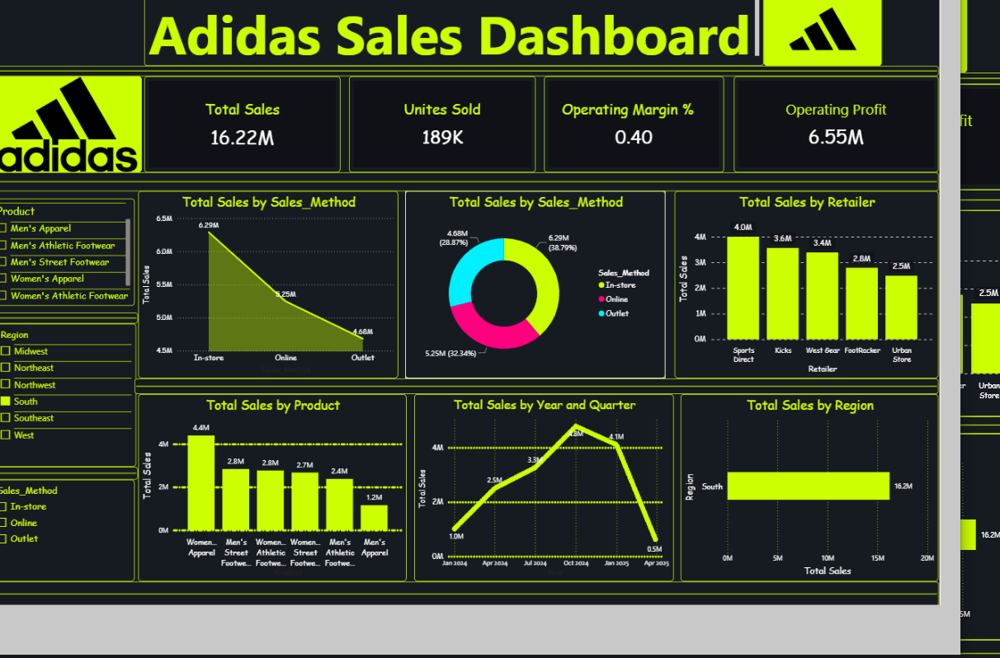

 # Adidas Sales Analysis | Power BI Dashboard

An interactive, high-contrast dark-themed data analytics dashboard designed to analyze Adidas retail sales performance, regional revenue distribution, sales methods, and operating profits.

## 📊 Dashboard Preview


## 🚀 Project Overview
This project provides deep business insights into global retail operations:
- **Core Performance KPIs:** Tracks total sales, total units sold, operating profit, and overall operating margin percentages.
- **Sales Channel Analysis:** Visualizes revenue breakdown across In-store, Online, and Outlet sales methods using area and donut charts.
- **Product & Regional Insights:** Compares top-performing product categories (Apparel & Footwear) and regional sales performance.
- **Retailer Breakdown:** Evaluates top retailers by total sales to identify key business partners.

## 🛠️ Built With & Tools Used
- **Tool:** Microsoft Power BI
- **Data Processing / Source:** Python, Pandas, CSV Datasets
- **Design Theme:** Custom Dark Mode Neon Theme (`#0F1117` background, `#161B22` panels, and `#CCFF00` Adidas neon accents)
- **Interactive Features:** Real-time cross-filtering using slicers for Product, Region, and Sales Method.

## 📈 Key Dashboard Metrics (KPIs)
- **Total Sales:** $16.22M
- **Units Sold:** 189K
- **Operating Margin:** 0.40 (40%)
- **Operating Profit:** $6.55M

## 📂 Repository Structure
```text
├── Adidas_Sales.png               # Dashboard preview screenshot
├── adidas_sales_data.csv          # Cleaned dataset used in Power BI
├── adidas_theme.json              # Custom Power BI neon dark theme file
└── README.md                      # Project documentation
